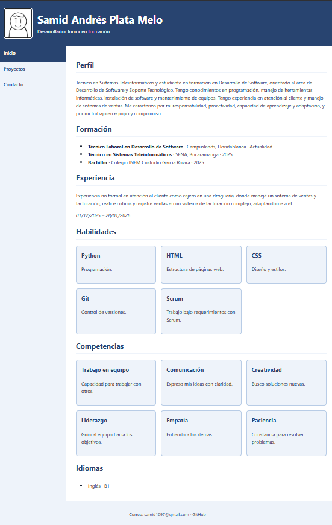
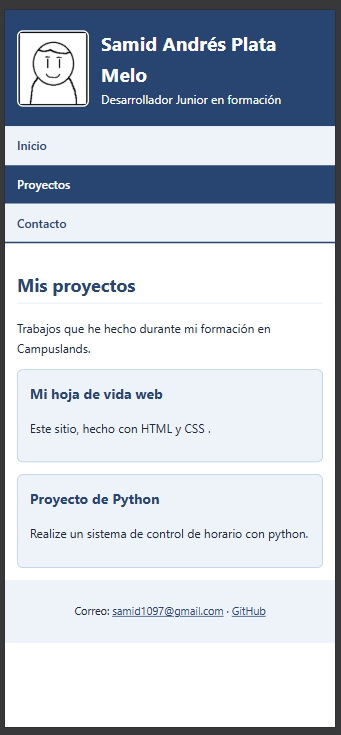
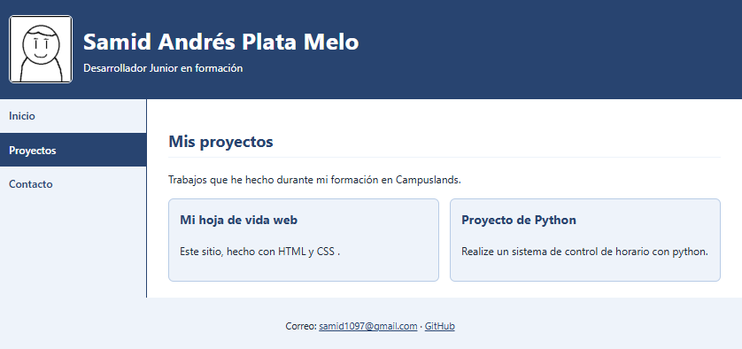
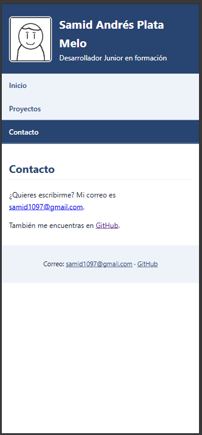
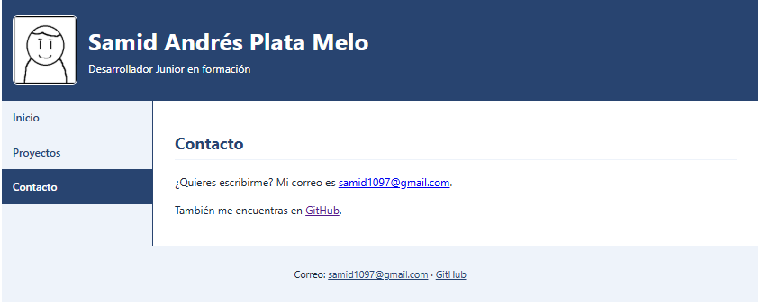

# Hoja de vida web · Samid Andrés Plata Melo

Sitio personal con mi hoja de vida y mis proyectos.

**Sitio publicado:** https://tu-usuario.github.io/hoja-de-vida/

## Páginas
- [index.html](index.html): hoja de vida
- [proyectos.html](proyectos.html): mis proyectos de clase
- [contacto.html](contacto.html): formas de contactarme

## Mockups
### Hoja de vida

### Proyectos

### Contacto

## Capturas del sitio publicado

## Breakpoints
- Base (celular): todo en una columna; el menú queda debajo de la cabecera, en vertical.
- Desde 600px: el menú pasa a una fila horizontal y el contenido tiene más margen.
- Desde 1024px: el menú pasa a la izquierda y el contenido a la derecha (grid con áreas `cabecera`, `menu`, `principal`, `pie`).

## Cómo lo publiqué
1. (1. cree el repositorio en github )
2. (Subí mis archivos (index.html, proyectos.html, contacto.html, styles.css y las carpetas img/ y mockups/) con git add . y guarde los cambios con git commit )
3. (subi el proyecto a mi repositorio con git psuh)

## Fuentes consultadas
- (mis feuntes para consultas fueron las diferentes diaositivas que se veiron durante las clases)
