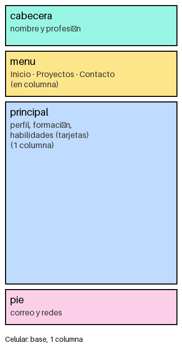
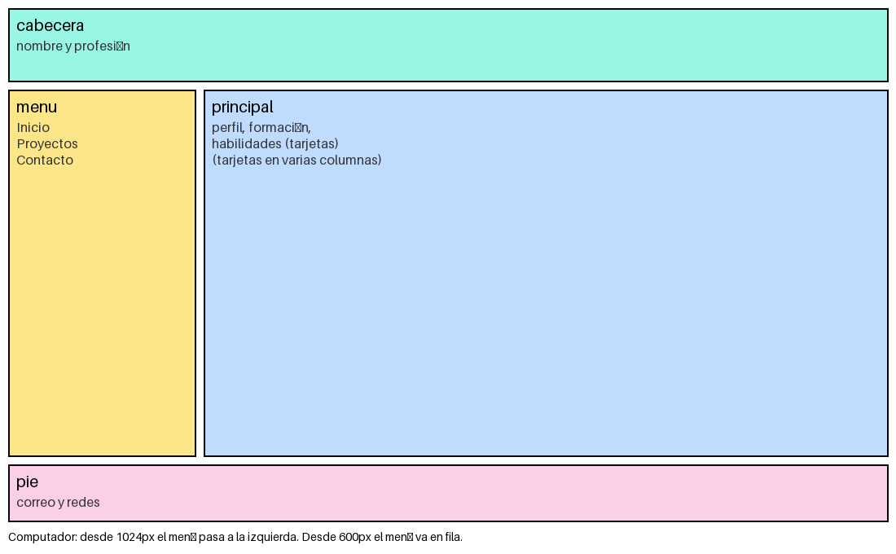
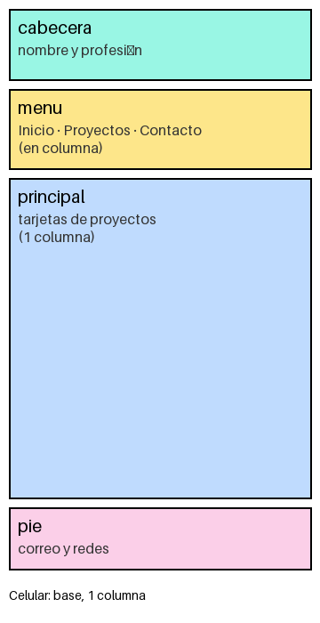
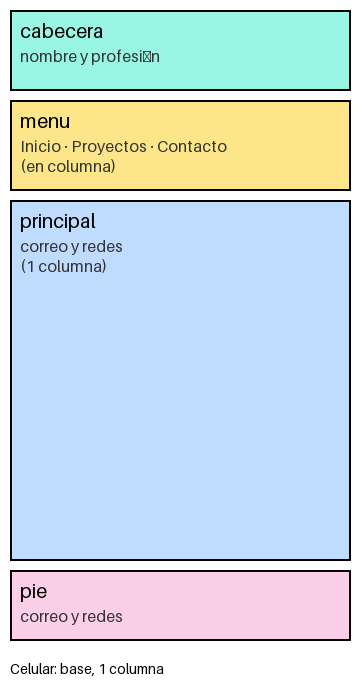
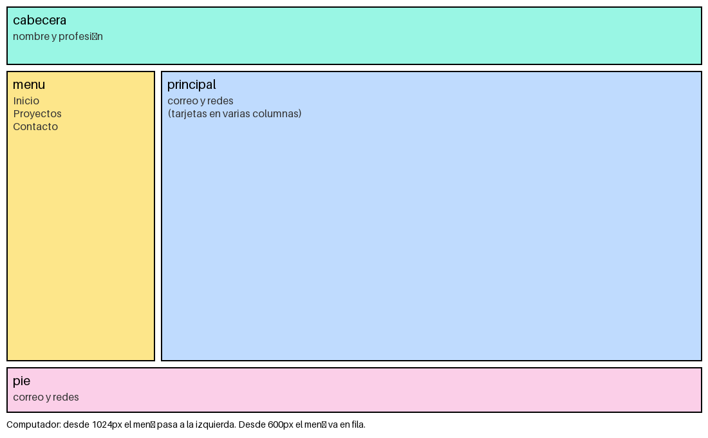

# Hoja de vida web · Samid Andrés Plata Melo

Sitio personal con mi hoja de vida y mis proyectos.

**Sitio publicado:** https://tu-usuario.github.io/hoja-de-vida/

## Páginas
- [index.html](index.html): hoja de vida
- [proyectos.html](proyectos.html): mis proyectos de clase
- [contacto.html](contacto.html): formas de contactarme

## Mockups
### Hoja de vida

### Proyectos

### Contacto

## Capturas del sitio publicado

## Breakpoints
- Base (celular): todo en una columna; el menú queda debajo de la cabecera, en vertical.
- Desde 600px: el menú pasa a una fila horizontal y el contenido tiene más margen.
- Desde 1024px: el menú pasa a la izquierda y el contenido a la derecha (grid con áreas `cabecera`, `menu`, `principal`, `pie`).

## Cómo lo publiqué
1. (Escribe aquí, con tus palabras, los pasos que seguiste.)

## Fuentes consultadas
- (Escribe aquí los enlaces que usaste, por ejemplo docs.github.com.)
